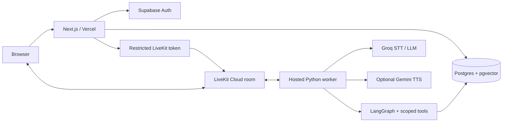

# Recall Voice

A multilingual voice workspace with LangGraph orchestration, inspectable memory, real tools, and separate cloud and local execution paths.

**Status: local implementation tested; not deployed or verified with live speech providers.** Cloud account setup is deferred. There is no production URL. The latest checks passed: 20 Python tests, 11 frontend unit tests, 4 desktop/mobile browser tests, lint, TypeScript, production build and hosted-worker import. Real Postgres, container and voice integration remain release gates. See [verification](docs/VERIFICATION.md).

## What is implemented

- Next.js/TypeScript interface: overview, conversation, memory editing/deletion/export, history, preferences, notes/tasks/reminders and document ingestion.
- LiveKit Python worker: room-bound identity, VAD, Groq multilingual Whisper, LangGraph streaming, optional Gemini speech, interruptions, database session expiry and provider-request admission.
- Bounded LangGraph tool loop: arithmetic without `eval`, UTC time, explicit memory, notes, tasks, durable in-app reminders, document retrieval. Tools cannot choose their user identity.
- SQLite local storage and checkpoints; Supabase schema, RLS, owner-scoped service routes, private PostgreSQL checkpoints, pgvector search functions and atomic demo admission.
- Optional CPU multilingual embeddings; explicitly labeled lexical retrieval when no embedding model is configured.
- Local text API with Ollama and optional faster-whisper recording transcription. Local speech is turn-based, not WebRTC streaming.
- CI checks, dependency scanning, agent Dockerfile and disabled-by-default deployment automation.

**Important limits:** English, Hindi and Telugu audio are experimental until measured tests pass. No external notification delivery is claimed: reminders are durable records shown inside the app. Browser speech requires an installed matching voice. No sample histories, tool results, live status or performance numbers are fabricated.

## Local setup on Windows

Prerequisites: Node.js 24 LTS, pnpm 10.24, Git, `uv`, and Ollama. Python 3.11–3.13 is supported; the development environment used 3.13. Hardware detected: i7-1360P, approximately 16 GB RAM, Intel Iris Xe. No CUDA assumption.

```powershell
cd 'D:\WorkSpace\ME\Ai Voice Agent'
.\scripts\hardware.ps1
.\scripts\setup.ps1
ollama pull qwen3:4b
```

Ollama is not installed by the setup script. Install it from its official distribution first. Pulling a model downloads several GB; smaller `qwen3:1.7b` is suitable for less memory but tool/language accuracy needs testing. Start Ollama with its desktop service or `ollama serve`.

Edit `services/agent/.env`:

```dotenv
LLM_PROVIDER=ollama
LLM_MODEL=qwen3:4b
OLLAMA_BASE_URL=http://localhost:11434
ALLOWED_ORIGINS=http://localhost:3000
LOCAL_API_KEY=replace-with-a-long-random-local-secret
```

Set `apps/web/.env.local`:

```dotenv
NEXT_PUBLIC_LOCAL_API_URL=http://127.0.0.1:8000
```

Start two terminals:

```powershell
cd services/agent
uv run uvicorn voice_agent.api:app --host 127.0.0.1 --port 8000
```

```powershell
cd apps/web
pnpm dev
```

Open [localhost:3000](http://localhost:3000). In Settings, enter your local access key **before** starting a session for persistent memory; leave it empty for an isolated guest session. The key is held only in page memory. Never put it in a `NEXT_PUBLIC_` variable. Enable memory consent before asking the agent to remember a fact.

Local sessions expire after five minutes. Create another session with the local key to retrieve persistent memories. The local API binds only to loopback and is not suitable for internet exposure.

### Optional local speech and semantic retrieval

```powershell
cd services/agent
uv sync --extra local-speech --extra embeddings
```

Set `WHISPER_MODEL=base` (or `small` on this 16 GB machine) and optionally `EMBEDDING_MODEL=sentence-transformers/paraphrase-multilingual-MiniLM-L12-v2`. The embedding model must output 384 dimensions. First use downloads the models. Restart the API after changing environment settings.

Use **Record a turn**, then stop, review the transcription and send. Recording is capped at 30 seconds and 3 MB. This is a CPU-compatible fallback; no local real-time latency claim is made. Enable browser speech in Settings only if your OS supplies the desired language voice. Missing Hindi/Telugu voices fall back to text.

The embedding package/model and faster-whisper weights were not downloaded or benchmarked in this session. Semantic ranking is covered with controlled vectors; actual model quality needs testing. IndicF5 is not bundled: it requires consented reference audio, gated model access and a separate CPU benchmark. See [language validation](docs/LANGUAGES.md).

## Checks

```powershell
cd services/agent
uv sync --extra voice
uv run ruff check voice_agent tests
uv run ruff format --check voice_agent tests
uv run pytest -q
uv run python -c "import voice_agent.worker"
```

```powershell
cd apps/web
pnpm install --frozen-lockfile
pnpm lint
pnpm typecheck
pnpm test
pnpm build
pnpm exec playwright install chromium
pnpm exec playwright test
```

The browser suite tests a deliberately **unconfigured** installation. Do not run it against production credentials. Live audio and PostgreSQL RLS tests require isolated configured services; use the release checklist before publishing.

## Public deployment

The public architecture does not depend on the developer's computer:



Follow [DEPLOYMENT.md](docs/DEPLOYMENT.md) after creating the accounts. Do not enable paid fallbacks or assume temporary signup credits are recurring free allowances. Keep `DEPLOY_ENABLED` unset until secrets, limits, schema and smoke tests are configured.

## Documentation

- [Architecture and alternatives](docs/ARCHITECTURE.md)
- [Original brief](docs/REQUIREMENTS.md)
- [Phase acceptance criteria](docs/IMPLEMENTATION.md)
- [Security boundaries](docs/SECURITY.md)
- [Deployment runbook](docs/DEPLOYMENT.md)
- [Language tests](docs/LANGUAGES.md)
- [Verification ledger](docs/VERIFICATION.md)
- [Portfolio case study](docs/CASE_STUDY.md)

No repository URL, live demo link or recorded walkthrough exists yet. Set `NEXT_PUBLIC_GITHUB_URL` after publishing the repository. Do not present this as a deployed portfolio deliverable until the release gates pass.
